<p align="center"></p>

<p align="center"></p>

The animation above shows the same two commands. The transcript below is their exact output, for readers who cannot see the animation:

```text
$ php agent.php ask "how do I sort an array?"

Sorting arrays - sort, rsort, asort, ksort, usort  [Exact match]
-------------------------------------------------
Category: Arrays

sort re-indexes and sorts values. asort keeps keys attached to values. ksort sorts by key. usort sorts with your own comparison function, for example by a field inside each item. Sorting functions change the array in place and return true or false, not the sorted array.

$marks = [85, 92, 78];
sort($marks);
print_r($marks);
$prices = ["pen" => 10, "book" => 50, "bag" => 300];
asort($prices);
print_r($prices);
$users = [["name" => "B", "age" => 30], ["name" => "A", "age" => 20]];
usort($users, fn($a, $b) => $a["age"] <=> $b["age"]);
print_r($users);


Common mistake: sort returns a boolean, not the array. Writing $sorted = sort($arr) gives you true, not a sorted array.

Related: Arrays - indexed, associative, and nested arrays | array_map, array_filter, array_reduce - transform arrays without loops
Function: true sort(array &$array, int $flags = SORT_REGULAR)  [standard]  https://www.php.net/manual/en/function.sort.php

$ php agent.php fn str_replace

str_replace()
Signature: array|string str_replace(array|string $search, array|string $replace, array|string $subject, &$count = NULL)
Extension: standard
Docs: https://www.php.net/manual/en/function.str-replace.php
Verified example: curated entry "string-functions".
```

# PHP Agent

An offline PHP expert, written in PHP itself. Ask a question in English,
get a short explanation and a complete, runnable PHP code
example — from a pre-decided local knowledge base, with no account and no
key required. English only: all questions, answers, keywords, and UI text
are in English. An optional AI box (localhost only) adds Gemini answers
grounded in the same local data, using your own free API key.

Local mode makes **no network calls at all**. The only network call in the
whole project is the Gemini request, and only when you have configured
your own key and asked a Gemini-mode question.

## What is in v2

| Layer | Count | What it is |
|---|---|---|
| Curated entries | 115 entries, 21 categories | Hand-written answers with verified, runnable code examples (v0.1.0, unchanged) |
| Function index | 1,180 functions | Generated by PHP reflection on PHP 8.3.6 (see below) — signature, extension, deprecation flag, php.net link. No invented descriptions. |
| Language constructs | 23 constructs | `echo`, `isset`, `include`, `list`, `eval`, `match`, `yield`, and more — labelled as constructs, not functions, each with a verified example. |
| Custom commands | 6 built-ins | `/explain`, `/example`, `/compare`, `/debug`, `/cheat`, `/fn` — defined in JSON, no code change to add one. |

## Honest limits

Read this before assuming what the agent can do:

- **Local answers are pre-decided.** The local agent answers from exactly
  the 115 curated entries. It never invents an answer: below the match
  threshold it says the topic is not in the knowledge base yet and shows
  the 3 closest topics.
- **"All functions" means the reflection index.** The index is complete
  for the PHP install it was generated on (this project's build machine:
  PHP 8.3.6 with the extensions listed in `data/all-functions.json`). An
  install that loads different extensions (for example `mysqli`,
  `mbstring`, `curl`, `gd`, `intl`) has a different function list.
  Re-run `php tools/generate-function-index.php` on any install to
  regenerate a complete index for that install. Function entries carry no
  invented descriptions: signature + extension + php.net link + a link to
  a verified curated example when one already exists, and an explicit
  "no verified example yet" note otherwise.
- **It does not run your code.** Code examples are teaching snippets. The
  test suite executes the runnable ones to prove they work, but the agent
  itself never executes anything you type.
- **Gemini answers are the model's, not verified.** In Gemini mode the
  model is grounded in the local data (top local matches + the function
  signature), but its output is not checked by the test suite. Local mode
  is the verified layer. Live Gemini answers were never verified while
  building this project: verification needs your key on your machine.
- **Snippets need adapting.** Database credentials, file paths, and
  validation rules in the examples are placeholders for a real project.
- **The default model name was not verified live.** `config/gemini.php`
  defaults to `gemini-2.5-flash`. If Gemini returns HTTP 404, change
  `model` there to a model available for your key.

## Requirements

PHP 8.1 or newer, command line. No Composer packages. The matcher works
with or without `mbstring`. The Gemini client uses the `curl` extension
when it is present and falls back to PHP streams when it is not. Check
your version first:

```bash
php -v
```

## Run it

```bash
# One question (CLI). `ask` is optional.
php agent.php ask "how do I connect to MySQL with PDO?"
php agent.php "how do I sort an array?"

# Interactive chat loop (type exit to quit). It remembers the last topic,
# so "example" after a question shows that topic's example.
php agent.php

# Exhaustive function lookup: any built-in function, by exact name.
php agent.php fn str_replace
php agent.php search str_replace

# Built-in commands
php agent.php help
php agent.php topics
php agent.php search password hash
php agent.php category:Security
php agent.php /explain str_replace
php agent.php /example "how do I sort an array?"
php agent.php /compare sort vs asort
php agent.php /debug "headers already sent"
php agent.php /cheat Arrays

# Smart web UI: search box, instant suggestions, command chips,
# recent/pinned topics, follow-ups. Localhost only.
php -S localhost:8000 -t public
# then open http://localhost:8000 in a browser
# AI box (Local / Gemini toggle): http://localhost:8000/ai.php

# Gemini mode from the CLI (needs your key - see below)
php agent.php ai "how do I sort an array in PHP?"

# Demo: 8 sample questions and answers
php demo.php

# Regenerate the function index for YOUR PHP install
php tools/generate-function-index.php

# Tests (plain PHP runners, no PHPUnit, no real network)
php tests/run-all.php
```

## Use it from your own PHP code

```php
<?php
require __DIR__ . '/src/PhpAgent.php';

$agent = PhpAgent::create(); // defaults to data/ next to src/
$result = $agent->answer('how do I sort an array?');

if ($result['status'] === 'found') {
    echo $result['entry']['title'] . "\n";
    echo $result['entry']['answer'] . "\n";
    echo $result['entry']['code'] . "\n";
} else {
    // 'not_found': $result['suggestions'] holds the 3 closest entries.
    echo "Not in the knowledge base yet.\n";
}

// Follow-ups: pass the previous topic id as the 2nd argument.
$followUp = $agent->answer('example', $result['entry']['id']);

// Listing helpers:
$agent->categories();          // string[]
$agent->byCategory('Security'); // entries in one category
$agent->search('password hash'); // up to 5 ranked entries
$agent->all();                 // every curated entry
$agent->index()->find('str_replace'); // function-index entry or null
$agent->groundingFor('how do I use str_replace?'); // local grounding for Gemini
```

`PhpAgent::answer()` returns an array with `status` (`found`, `not_found`,
`help`, `topics`, `search`, `category`, `function`, `command`), `entry`
(the best entry or `null`), `score`, `suggestions`, and `query`. A
`function` result carries a `function` entry (signature, extension, url)
or `null` plus `closest` names. Match confidence is shown in plain words
in the UI: Exact (score >= 100), Close (>= 25), Related (> 0).

## How matching works

1. The question is normalised (lowercased, punctuation stripped) and split
   into tokens. English synonyms are expanded (`fetch` → `get`,
   `make` → `create`, `append` → `add`, and others), so differently
   worded questions match the same keywords.
2. Every entry is scored: an exact PHP function name in the question scores
   highest, then whole-word keyword phrases, then
   title words (including shared stems such as `prepare`/`prepared`), then a
   fuzzy fallback for near-misses on function names and titles.
3. A match needs a score of at least 25. Below that, the agent reports the
   topic as missing instead of guessing.
4. Ties break by entry id, so the same input always returns the same answer.
5. A bare function name with no curated match resolves to the exhaustive
   function index instead, and close misspellings get "Did you mean?"
   suggestions from Levenshtein distance over indexed names.

## Function index: how "all" was generated

`tools/generate-function-index.php` uses `get_defined_functions()` and
`ReflectionFunction` on the machine it runs on. For every internal
function it records the exact name, extension, a signature built from
reflection (parameter names, types including union/nullable, default
values rendered safely, variadic and by-reference markers, return type),
whether it is deprecated, a php.net URL, and a link to a verified curated
example when one already names that function (`example: null` otherwise).
No description is written by hand or by a model.

The committed `data/all-functions.json` was generated on PHP 8.3.6 with
35 loaded extensions (Core, standard, date, json, PDO, SPL, session,
hash, filter, pcre, and others — the full list is in the file header).
Extensions this install does not load (`mysqli`, `mbstring`, `curl`, `gd`,
`intl`, `dom`, and others) are absent from the committed index, exactly
as the honesty rule above states. Re-run the generator on the machine
where the agent will run to get that machine's complete list.

## Language constructs

`data/language-constructs.json` covers 23 constructs: `echo`, `print`,
`isset`, `empty`, `unset`, `include`, `include_once`, `require`,
`require_once`, `list`, `eval`, `exit`, `die`, `declare`, `clone`,
`instanceof`, `new`, `throw`, `yield`, `yield from`, `match`,
arrow functions (`fn`), and `static` variables. Each has correct syntax,
one verified example (runnable ones are executed in the test suite), and
a pitfall. Constructs are looked up with `fn <name>` and are labelled as
constructs everywhere, never as functions.

## Custom commands

Commands are data in `data/custom-commands.json`: each has a `name`, a
`description`, a `mode` (`local` or `gemini`), and a `template` with a
`{query}` placeholder. Built-ins:

| Command | Mode | What it does |
|---|---|---|
| `/explain <topic>` | gemini | Local signature + curated answer; grounded Gemini answer when a key is configured, local fallback otherwise |
| `/example <topic>` | local | The curated code example only; honest when none exists |
| `/compare <a> vs <b>` | local | Both signatures/answers side by side |
| `/debug <error text>` | local | Matches Common Errors entries; honest no-match otherwise |
| `/cheat <category>` | local | Lists every curated entry in the category |
| `/fn <name>` | local | Function-index lookup |

Add your own with one JSON entry, no code change:

```json
{
  "name": "/security",
  "description": "Show the security checklist for a topic.",
  "mode": "local",
  "template": "Security checklist for {query}."
}
```

Then implement its behaviour in `src/CustomCommands.php` if it needs new
logic; the command registry, help text, and web chips pick it up from
the JSON file. A command with a bad `mode` is rejected with a clear
error instead of crashing (tested).

## Gemini AI box (BYOK, localhost only)

The AI box runs at `http://localhost:8000/ai.php` (and from the CLI with
`php agent.php ai "..."`). It uses **your own** free Google AI Studio key.
No key was created while building this project, and no live Gemini answer
was verified here.

Setup, on your own machine:

1. In your own browser, create a free key at Google AI Studio:
   `aistudio.google.com/apikey` (free tier).
2. Run `php setup-gemini.php` and paste the key, or set the
   `GEMINI_API_KEY` environment variable. Key resolution order: env var,
   then `config/key.php`, then `.env`.
3. The key is stored only on your machine, in `config/key.php` with mode
   0600. `.gitignore` covers `config/key.php` and `.env`; the test suite
   fails if a key literal appears anywhere outside the tests.

How grounding works: before calling Gemini, the agent injects the top-3
local curated matches and the function-index signature for any function
name in the question, and instructs the model to prefer that local data,
never invent a signature, show code + one pitfall, and say when the
topic is not in local data. The AI box shows a "Local data" badge naming
the entries that grounded each answer. Temperature is 0.2 and
`max_output_tokens` is 1024, both configurable in `config/gemini.php`.

If the key is missing, Gemini mode shows setup instructions and the local
answer instead of failing. If Google rejects the key (HTTP 401/403), the
message says so plainly and suggests a fresh AI Studio key: a key can be
rejected when its Google Cloud project has no Gemini API access. A 404
means the configured model name is not available for the key — change
`model` in `config/gemini.php`. No stack traces are shown to the user,
and the key is never printed or logged (status output shows only the
first 4 and last 4 characters).

## Smart-engine UI and memory

`public/index.php` is a search-engine style home page: a large centred
search box with instant suggestions as you type (vanilla JavaScript only,
no framework, no CDN, no external requests). Suggestions come from
`public/suggest.php` on the same app and show the title, a
category/extension badge, and the match type (curated answer, function
signature, language construct, custom command). Keyboard: up/down +
Enter to pick; clicking a suggestion opens its full answer. Code blocks
have a Copy button.

Memory, fully local:

- **Server session (PHP `$_SESSION`):** the conversation history and the
  last topic are remembered, so follow-ups like "example", "show me an
  example", or "tell me more" resolve against the previous topic, on
  both pages and in the CLI interactive loop.
- **Browser localStorage (localhost only, nothing leaves the machine):**
  recent searches and pinned topics are remembered and shown as Recent
  and Pinned chips, with a Clear history button.
- **Answer page:** shows Related topics from the same category and the
  function signature card when the entry is about a built-in function,
  plus "Did you mean?" for close misspellings. Match confidence is shown
  in plain words (Exact / Close / Related), never as a raw number dump.

## Knowledge base inventory (115 entries, 21 categories)

| Category | Entries |
|---|---|
| Basics | 15 |
| OOP | 9 |
| Arrays | 8 |
| PHP 8 Features | 8 |
| Strings | 7 |
| Security | 6 |
| PDO & Databases | 6 |
| Files | 5 |
| HTTP, JSON & APIs | 5 |
| Laravel-Style Patterns | 5 |
| Performance, CLI & Deployment | 5 |
| Common Errors | 5 |
| Errors & Exceptions | 4 |
| Sessions & Cookies | 4 |
| Forms & Validation | 4 |
| WordPress | 4 |
| Testing & Debugging | 4 |
| Functions | 3 |
| Regular Expressions | 3 |
| Composer & Autoloading | 3 |
| MySQLi | 2 |

Each entry has an `id`, `title`, `category`, `keywords` (English phrases), `functions`, a short plain-English
`answer`, a complete `code` example, the expected `output` where the
example produces one, a `runnable` flag, a common-mistake `pitfall`, and
`related` entry ids. Entries marked `runnable: false` need a database,
a web server, or a framework, and are syntax-checked only.

Topics include: variables and types, operators, strings, arrays, control
flow, functions and closures, classes, traits, interfaces, enums,
attributes, errors and exceptions, dates, files, sessions and cookies,
forms and validation, superglobals, XSS/SQL injection/CSRF prevention,
`password_hash`, prepared statements, PDO and MySQLi, cURL, JSON/XML,
regex, Composer/autoloading, PHP 8 features (named arguments, `match`,
nullsafe operator, union types, fibers, readonly properties), Laravel-style
routing/MVC/middleware patterns in plain PDO, WordPress hooks, REST APIs,
PHPUnit concepts, debugging, performance, deployment, CLI scripts, and
fixes for the most common PHP errors.

## Example questions

```text
how do I connect to MySQL with PDO?
how do I sort an array?
how do I get a value from an array?
how do I use str_replace in PHP?
how to use password_hash and password_verify
how do I create a session?
how do I prevent XSS in PHP?
how do I create a csrf token?
how do I use match in PHP?
how do I create an enum?
fn str_replace
/compare sort vs asort
/debug headers already sent
```

## Project structure

```text
agent.php                 CLI: one-shot, interactive loop, fn lookup, custom commands, Gemini mode
demo.php                  8 sample Q&A pairs from the knowledge base
setup-gemini.php          Interactive Gemini key setup (key stored locally only, mode 0600)
public/index.php          Search-style web home (suggestions, chips, recent/pinned)
public/ai.php             AI box: Local / Gemini toggle, session history, grounding badge
public/suggest.php        Local JSON suggestion endpoint (no network)
public/ui.php             Shared rendering + vanilla JS (suggestions, memory, copy)
index.php                 Alternate web UI at the project root (GET form)
src/lib.php               Loading, normalising, scoring, matching, confidence labels
src/PhpAgent.php          Library API: PhpAgent::answer(string, ?contextId, ?gemini): array
src/FunctionIndex.php     Exhaustive function index + language constructs loader
src/CustomCommands.php    Data-driven custom commands (/explain, /example, ...)
src/GeminiClient.php      BYOK Gemini REST client (cURL or streams, mockable transport)
src/Suggest.php           Suggestion engine (curated + functions + constructs + commands)
config/gemini.php         Gemini settings (model, temperature, tokens, timeout)
tools/generate-function-index.php  Reflection generator for data/all-functions.json
data/*.json               Curated knowledge base (21 files, 115 entries)
data/all-functions.json   Generated function index (1,180 functions, PHP 8.3.6)
data/language-constructs.json  23 language constructs with verified examples
data/custom-commands.json Command definitions (JSON, no code change to add one)
tests/run.php             v1 suite: entries, matcher, CLI, no-network scan
tests/run-v2.php          v2 suite: index, constructs, commands, Gemini mocks, UI/HTTP
tests/run-all.php         Runs both suites, one total
```

## Tests

`php tests/run-all.php` runs both suites and prints one total. The v1
suite asserts every curated entry's fields, lint + execution of every
runnable example, 46 matcher cases, unknown-question honesty,
determinism, and that no shipped offline file makes a network call (the
Gemini client and php.net URL builders are allowlisted and checked
separately for key leakage). The v2 suite asserts the generated index
(count, keys, no invented descriptions, stable regeneration), all 23
constructs (lint + execution + outputs), every custom command (including
a deliberately broken config), `fn`/`search` resolution, session
follow-ups (in-process and over HTTP with cookies), grounding injection,
Gemini payload/masking/401/404/missing-key handling with a mock
transport (no real HTTP request in any test), the suggestion endpoint
over a local server, and that no web page loads any external asset.

Exit code 0 means every assertion passed.

## Contributing

Adding a topic needs no code change — add one JSON object to the right
file in `data/` (or a new `data/NN-name.json` file):

```json
{
  "id": "example-topic",
  "title": "Example topic",
  "category": "Basics",
  "keywords": ["example", "how to show an example"],
  "functions": ["example_fn"],
  "answer": "Short explanation in simple words.",
  "code": "echo \"example\";\n",
  "output": "example",
  "runnable": true,
  "pitfall": "The one mistake beginners make here.",
  "related": ["hello-first-program"]
}
```

Rules for new entries:

- `id` is lowercase letters, digits, and hyphens, and must be unique.
- `code` must be correct PHP. If it runs standalone, set
  `"runnable": true` and set `output` to its exact output. If it needs a
  database, server, or framework, set `"runnable": false` and
  `"output": null` — it will be syntax-checked only.
- Include English keywords covering how a beginner would phrase the question.
- `related` ids must already exist.
- To cover a new built-in function, re-run the generator instead of
  hand-writing an index entry: `php tools/generate-function-index.php`.
- Run `php tests/run-all.php` before submitting; it must exit 0.

## License

MIT. See `LICENSE`.
